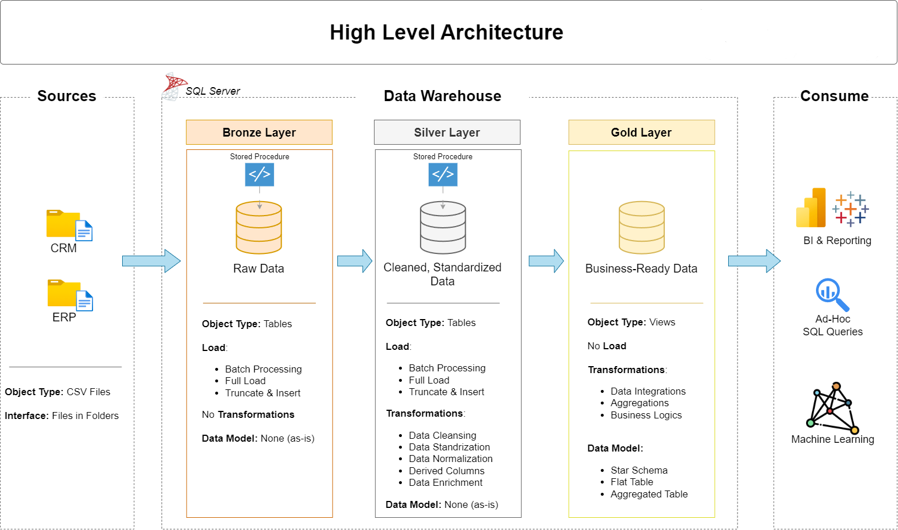

# SQL Server Data Warehouse Project

## Project Overview

This project focuses on building a SQL Server Data Warehouse that transforms raw data from CRM and ERP source systems into clean, standardized, and meaningful data.

The data warehouse follows a Medallion Architecture consisting of three layers: Bronze, Silver, and Gold. Each layer performs a specific role in the data processing pipeline, from raw data ingestion to preparing business-ready data.

The final data is organized into fact and dimension views that can be used for Power BI reporting, machine learning applications, and other downstream data solutions.

## Data Warehouse Architecture



- **Bronze Layer:** Stores raw data extracted from CRM and ERP CSV files.
- **Silver Layer:** Cleans, standardizes, and transforms raw data to improve data quality and consistency.
- **Gold Layer:** Integrates transformed data and provides business-ready fact and dimension views using a star schema.

### Data Flow

```text
CRM and ERP Source Systems
          |
          v
     CSV Files
          |
          v
    Bronze Layer
      Raw Data
          |
          v
    Silver Layer
 Cleaned and Standardized Data
          |
          v
     Gold Layer
 Fact and Dimension Views
          |
          v
   Downstream Applications
  Power BI / Machine Learning
```

## Tools and Technologies

- **Microsoft SQL Server** – Database platform for storing and processing data.
- **SQL Server Management Studio (SSMS)** – Used to develop, execute, and manage SQL scripts.
- **SQL** – Used for data ingestion, transformation, validation, and data modeling.
- **CSV Files** – Source files containing CRM and ERP data.
- **Git and GitHub** – Used for version control and project documentation.

## Data Sources

The data warehouse uses CSV files from two source systems:

### CRM (Customer Relationship Management)

Contains customer-related and product-related business information, depending on the source files provided.

### ERP (Enterprise Resource Planning)

Contains additional business data from the ERP system, including supporting information used to enrich the warehouse data.

The source files contain different data types, such as integers, decimal numbers, strings, and dates. These files are loaded into SQL Server for further processing.

## ETL Process

### 1. Extract

- Extract data from CRM and ERP CSV files.
- Load the source data into the Bronze layer using SQL Server.
- Preserve the original source values as much as possible for traceability.

### 2. Transform

- Clean and standardize the raw data in the Silver layer.
- Handle null values, duplicates, and invalid data.
- Convert columns to appropriate data types.
- Standardize values and apply data quality rules.

### 3. Prepare Business-Ready Data

- Integrate the cleaned data in the Gold layer.
- Organize the data into fact and dimension views.
- Apply a star schema to support downstream reporting and data applications.

## Bronze Layer — Raw Data

The Bronze layer is the initial storage layer of the data warehouse. It stores raw data loaded from the source CSV files.

### Key Responsibilities

- Load raw CRM and ERP data into Bronze tables.
- Preserve source data for traceability.
- Use a full-load strategy where applicable.
- Organize raw data into separate tables based on source systems and entities.

### Example Tables

- `bronze.crm_cust_info`
- `bronze.crm_prd_info`
- `bronze.crm_sales_details`

## Silver Layer — Cleaned and Standardized Data

The Silver layer processes the raw data from the Bronze layer and improves its quality, consistency, and usability.

### Key Responsibilities

- Handle null values and duplicate records.
- Identify and handle invalid values.
- Standardize data formats and business values.
- Convert columns to appropriate data types.
- Apply data cleaning and validation rules.
- Store transformed data in Silver tables.

### Example Tables

- `silver.crm_cust_info`
- `silver.crm_prd_info`
- `silver.crm_sales_details`

## Gold Layer — Business-Ready Data

The Gold layer provides a structured representation of the cleaned and integrated data for downstream applications.

### Key Responsibilities

- Integrate data from relevant source entities.
- Create fact and dimension views.
- Implement a star schema for structured data access.
- Present data in a business-friendly format.
- Support Power BI reporting and other downstream applications.

### Data Modeling

The Gold layer uses a star schema consisting of:

- **Fact views:** Contain measurable business events and references to related dimensions.
- **Dimension views:** Contain descriptive information used to organize and provide context to business data.

The Gold layer exposes these views for consumption by downstream tools and applications.

## Database Structure

The database is organized into three schemas:

| Schema | Purpose |
|---|---|
| `bronze` | Stores raw data from source files. |
| `silver` | Stores cleaned and standardized data. |
| `gold` | Exposes business-ready fact and dimension views. |

Each schema separates the responsibilities of data ingestion, transformation, and presentation, making the data warehouse easier to maintain and extend.

### Prerequisites

- Microsoft SQL Server
- SQL Server Management Studio (SSMS)
- CRM and ERP source CSV files
- Git

## 👤 Author

**Ajay Bharati**

- LinkedIn: (https://www.linkedin.com/in/ajay44/)
- GitHub: Add your GitHub profile URL.

---

*This project demonstrates the development of a layered SQL Server Data Warehouse using a Medallion Architecture, SQL-based data transformation, and dimensional data modeling.*
